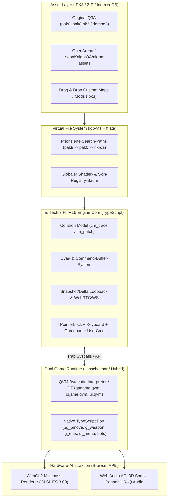
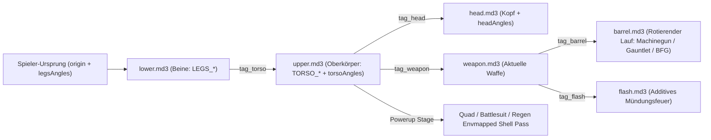

# Ultra-Detaillierter Masterplan: 100% Quake III Arena (1999) — HTML5 / WebGL2 Engine & Original-Asset-Port

> **Projektziel:** Eine **100% originalgetreue, bit- und physik-exakte Umsetzung von Quake III Arena (id Tech 3, 1999)** im Browser auf Basis von **HTML5, TypeScript, WebGL2 (OpenGL ES 3.0) und Web Audio API** – inklusive vollständiger Unterstützung aller originalen **`.PK3`-Archive** (`Quake III Arena Retail/Demo`, `OpenArena`, [`NeonKnightOA/nk-oa-assets`](https://github.com/NeonKnightOA/nk-oa-assets) sowie kompatibel zur [`q3js`](https://github.com/inolen/quakejs)-Architektur), aller **`.BSP` (v46)** Maps, **`.MD3` (v15)** Multipart-Modelle mit **Tag-Rigging**, des kompletten **Quake-III-Multipass-Shader-Systems (`scripts/*.shader`)**, **QVM-Bytecode-Ausführung (`.qvm`)** sowie nativer Game-Logik, **125-Hz-Strafe-Jump-Physik (`bg_pmove`)**, **3D-Positional-Audio**, **Bots** und **WebRTC/WebSocket-Multiplayer**.

---

## Inhaltsverzeichnis

1. [Systemarchitektur & Dual-Runtime-Strategie (Native TS + QVM)](#1-systemarchitektur--dual-runtime-strategie-native-ts--qvm)
2. [Asset-Pipeline, Virtual File System (VFS) & `.PK3`-Integration](#2-asset-pipeline-virtual-file-system-vfs--pk3-integration)
3. [Binärformat-Spezifikation & Parser (`.BSP` v46, `.MD3` v15, `.ROQ`, `.WAV`)](#3-binärformat-spezifikation--parser-bsp-v46-md3-v15-roq-wav)
4. [Quake III Multipass-Shader-System & Dynamischer GLSL-Transpiler](#4-quake-iii-multipass-shader-system--dynamischer-glsl-transpiler)
5. [WebGL2-Rendering-Pipeline (PVS, Lightmaps, Bezier-Patches, Skybox, Portale, Flares)](#5-webgl2-rendering-pipeline-pvs-lightmaps-bezier-patches-skybox-portale-flares)
6. [MD3-Tag-Rigging, `animation.cfg` & GPU-Vertex-Morphing](#6-md3-tag-rigging-animationcfg--gpu-vertex-morphing)
7. [Kollisionserkennung (`CM_BoxTrace`) & 100% Authentische Quake-3-Physik (`Pmove`)](#7-kollisionserkennung-cm_boxtrace--100-authentische-quake-3-physik-pmove)
8. [Komplettes Waffen-, Item-, Powerup- & Schadenssystem (1999 Specs)](#8-komplettes-waffen--item--powerup---schadenssystem-1999-specs)
9. [QVM-Interpreter / JIT (`game.qvm`, `cgame.qvm`, `ui.qvm`) & Syscall-Bridge](#9-qvm-interpreter--jit-gameqvm-cgameqvm-uiqvm--syscall-bridge)
10. [Web Audio API 3D-Sound-Engine, Musik & Announcer-System](#10-web-audio-api-3d-sound-engine-musik--announcer-system)
11. [Original UI, 3D-HUD, Drop-Down-Konsole, Cvars & `.RoQ`-Videodecoder](#11-original-ui-3d-hud-drop-down-konsole-cvars--roq-videodecoder)
12. [Bot-KI (`.aas` Area Awareness System & Fuzzy-Logic) & Multiplayer-Netzwerk](#12-bot-ki-aas-area-awareness-system--fuzzy-logic--multiplayer-netzwerk)
13. [Projekt-Verzeichnisstruktur & Modul-Schnittstellen](#13-projekt-verzeichnisstruktur--modul-schnittstellen)
14. [Phasenweiser Implementierungs- & Verifikationsplan](#14-phasenweiser-implementierungs---verifikationsplan)

---

## 1. Systemarchitektur & Dual-Runtime-Strategie (Native TS + QVM)

Die originale **id Tech 3 Engine** (GPLv2) ist strikt in zwei Schichten getrennt:
1. **Engine-Core (`client`, `server`, `renderer`, `cm`, `snd`, `qcommon`)**: Zuständig für VFS (`.pk3`), BSP-Tracing, WebGL2-Rendering, Sound, Input und Netzwerk.
2. **Game-Logik (`qagame`, `cgame`, `ui`)**: In Quake 3 als isolierte **Quake Virtual Machine (`.qvm`)** Bytecode-Dateien innerhalb der `.pk3`-Archive ausgeliefert, die ausschließlich über definierte **Trap-Syscalls** mit der Engine kommunizieren.

Um sowohl **100% Kompatibilität mit Original-PK3s und Mods** (wie `q3js` / `ioquake3`) als auch **maximale Erweiterbarkeit und Debugbarkeit in TypeScript** zu erreichen, implementiert diese Architektur eine **Dual-Runtime**:



### Koordinatensystem-Konvention (Keine Swizzle-Divergenz!)
Quake III verwendet ein **rechtshändiges Z-Up-Koordinatensystem**:
- $+X$ = Vorwärts (Osten), $+Y$ = Links (Norden), $+Z$ = Oben (Himmel).
- **Wichtiges Design-Prinzip:** Alle internen Berechnungen (BSP-Geometrie, `CM_BoxTrace`, `Pmove`, `MD3`-Tags, Partikel, Sound-Positionen) verbleiben **zu 100% im originalen Quake-Z-Up-Koordinatenraum**!
- Erst in der **View-Matrix** des Renderers wird die Basistransformation von Quake-Space nach OpenGL/WebGL-View-Space durchgeführt:

$$M_{\text{Quake}\to\text{GL}} = \begin{bmatrix} 0 & -1 & 0 & 0 \\ 0 & 0 & 1 & 0 \\ -1 & 0 & 0 & 0 \\ 0 & 0 & 0 & 1 \end{bmatrix}$$

Dadurch stimmen Physik-Traces, Lichtgitter-Abfragen (`Lightvols`), Tag-Matrizen und gerenderte Polygone ohne jegliche Konvertierungsfehler exakt überein.

---

## 2. Asset-Pipeline, Virtual File System (VFS) & `.PK3`-Integration

### 2.1 Unterstützte Asset-Quellen & Dreistufige Fallback-Kette

| Quelle | Beschreibung | Lizenz / Bereitstellung |
| :--- | :--- | :--- |
| **1. Original Quake III Arena (`baseq3`)** | Retail `pak0.pk3` (457 MB) + Point-Release `pak1.pk3` bis `pak8.pk3` oder `demoq3/pak0.pk3` (`q3dm1`, `q3dm7`, `q3dm17`, `q3tourney2`). | Lokaler Upload per Drag-&-Drop, File System Access API oder lokales `/assets/baseq3/` Verzeichnis. |
| **2. `NeonKnightOA/nk-oa-assets` & `OpenArena`** | 100% GPLv2-kompatible Ersatz-Assets mit identischen Dateipfaden (`models/weapons2/*`, `models/players/sarge/*`, `textures/base_wall/*`, `sound/feedback/*`, `scripts/*.shader`). | Automatischer Build-/Fetch-Download aus `NeonKnightOA/nk-oa-assets` bzw. OpenArena PK3-Paketen (`pak0.pk3`, `pak1-maps.pk3`, `pak6-patch088.pk3`). |
| **3. `q3js`-Kompatibles Asset-Streaming** | On-Demand-HTTP-Range-Request oder vorab gepackte Manifest-Bundles (`.pk3` über HTTP mit `Content-Range` + IndexedDB-Persistenz). | Sofortiger Spielstart im Browser ohne erneuten Download bei Reload. |

### 2.2 VFS-Regeln (Exaktes Verhalten von `qcommon/files.c`)
1. **Suchreihenfolge (`FS_BuildOSPath`):**
   - Höhere `.pk3`-Namen überschreiben niedrigere (`pak8.pk3` > `pak7.pk3` > ... > `pak0.pk3`).
   - Mod-Verzeichnisse (`fs_game`, z.B. `cpma`, `defrag`, `baseoa`) haben Vorrang vor `baseq3`.
   - `NeonKnightOA/nk-oa-assets` wird als Basis-Layer unterhalb von `pak0.pk3` gemountet, sodass jedes vorhandene Original-Asset Vorrang hat, aber jedes fehlende Asset nahtlos durch das OpenArena/NeonKnight-Äquivalent ergänzt wird.
2. **Pfad-Normalisierung:**
   - Alle Pfade im ZIP-Central-Directory werden beim Mounten in Kleinbuchstaben (`toLowerCase()`), mit `/` als Separator und ohne führenden Slash indiziert.
   - **Automatische Dateiendungs-Auflösung (`R_FindImageFile`):** Fragt ein `.shader` oder `.bsp` nach `textures/base_wall/concrete1.tga`, sucht das VFS der Reihe nach:
     1. Exakter Pfad (`textures/base_wall/concrete1.tga`)
     2. `.jpg` (`textures/base_wall/concrete1.jpg`)
     3. `.png` (`textures/base_wall/concrete1.png`)
     4. `.webp` (optional für optimierte Web-Pakete)
3. **Zero-Copy ZIP-Entpackung:**
   - Einsatz von `fflate` (extrem schneller WebWorker-fähiger Deflate-Decompressor in TypeScript) + `DataView` auf `ArrayBuffer`.
   - Beim Mounten einer `.pk3` wird zunächst **nur das Central Directory** am Ende der ZIP-Datei geparst (`O(1)` Header-Scan); einzelne Dateien (`.bsp`, `.md3`, `.tga`, `.wav`) werden erst bei Bedarf (`FS_ReadFile`) entpackt und in einer **IndexedDB (`q3_vfs_cache`)** gecacht.

---

## 3. Binärformat-Spezifikation & Parser (`.BSP` v46, `.MD3` v15, `.ROQ`, `.WAV`)

Alle Binärformate in Quake III sind **Little-Endian**. Der Parser arbeitet direkt mit `DataView` und typisierten Arrays (`Float32Array`, `Int32Array`, `Uint8Array`).

### 3.1 `.BSP` Format (`IBSP` Version `46` / `0x2E`)

#### Header-Struktur (144 Bytes)
```typescript
interface BspHeader {
  magic: string; // 4 Bytes ASCII: "IBSP" (0x49, 0x42, 0x53, 0x50)
  version: number; // int32: 46 (0x2E) für Quake III Arena
  lumps: Array<{ fileofs: number; filelen: number }>; // 17 Lumps × 8 Bytes = 136 Bytes
}
```

#### Vollständige Tabelle aller 17 BSP-Lumps

| Lump-ID | Name | Strukturlänge | Exaktes Binär-Layout (`DataView` Offsets) | Verwendung in der Engine |
| :---: | :--- | :---: | :--- | :--- |
| **0** | `LUMP_ENTITIES` | Variabel (ASCII) | `{ "classname" "worldspawn" ... }` Textblock | Map-Entities, Spawns, Lichter, Trigger, Mover (`*1..*n`), Items |
| **1** | `LUMP_SHADERS` | **72 Bytes** | `char shader[64]`, `int32 surfaceFlags` (`+64`), `int32 contentFlags` (`+68`) | Material-Referenz für Flächen & Kollisions-Brushes (`SURF_*`, `CONTENTS_*`) |
| **2** | `LUMP_PLANES` | **16 Bytes** | `float32 normal[3]` (`+0..+8`), `float32 dist` (`+12`) | BSP-Raumteilung & Brush-Kollisionsebenen ($\vec{n} \cdot \vec{x} = d$) |
| **3** | `LUMP_NODES` | **36 Bytes** | `int32 planeNum` (`+0`), `int32 children[2]` (`+4, +8`; negativ = `-(leafIndex + 1)`), `int32 mins[3]` (`+12..+20`), `int32 maxs[3]` (`+24..+32`) | Hierarchischer BSP-Baum für Punkt-in-Leaf-Suche & Frustum-Culling |
| **4** | `LUMP_LEAFS` | **48 Bytes** | `int32 cluster` (`+0`), `int32 area` (`+4`), `int32 mins[3]` (`+8`), `int32 maxs[3]` (`+20`), `int32 firstLeafSurface` (`+32`), `int32 numLeafSurfaces` (`+36`), `int32 firstLeafBrush` (`+40`), `int32 numLeafBrushes` (`+44`) | Blätter des BSP-Baums, PVS-Cluster-Index & Area-Portal-Index |
| **5** | `LUMP_LEAFSURFACES` | **4 Bytes** | `int32 surfaceIndex` | Indirektionsliste von Leaf auf `LUMP_SURFACES` |
| **6** | `LUMP_LEAFBRUSHES` | **4 Bytes** | `int32 brushIndex` | Indirektionsliste von Leaf auf `LUMP_BRUSHES` |
| **7** | `LUMP_MODELS` | **40 Bytes** | `float32 mins[3]` (`+0`), `float32 maxs[3]` (`+12`), `int32 firstSurface` (`+24`), `int32 numSurfaces` (`+28`), `int32 firstBrush` (`+32`), `int32 numBrushes` (`+36`) | `model[0]` = statische Welt; `model[1..N]` = bewegliche Brush-Modelle (`func_door`, `func_plat`, `func_pendulum`, `func_bobbing`) |
| **8** | `LUMP_BRUSHES` | **12 Bytes** | `int32 firstSide` (`+0`), `int32 numSides` (`+4`), `int32 shaderNum` (`+8`) | Konvexe Kollisionsvolumen für `CM_BoxTrace` |
| **9** | `LUMP_BRUSHSIDES` | **8 Bytes** | `int32 planeNum` (`+0`), `int32 shaderNum` (`+4`) | Begrenzungsebenen eines konvexen Brushes |
| **10** | `LUMP_DRAWVERTS` | **44 Bytes** | `float32 xyz[3]` (`+0`), `float32 st[2]` (`+12`), `float32 lightmap[2]` (`+20`), `float32 normal[3]` (`+28`), `uint8 color[4]` (`+40`, RGBA) | Geometrie-Vertices für Welt, Patches & Inline-Meshes |
| **11** | `LUMP_DRAWINDEXES` | **4 Bytes** | `int32 offset` (relativ zu `surface.firstVert`) | Dreiecks-Index-Liste für `MST_PLANAR` (1) und `MST_TRIANGLE_SOUP` (3) |
| **12** | `LUMP_FOGS` | **72 Bytes** | `char shader[64]` (`+0`), `int32 brushNum` (`+64`), `int32 visibleSide` (`+68`) | Volumetrische Nebel-Bereiche (Lava-Gruben, Nebel-Räume) |
| **13** | `LUMP_SURFACES` | **104 Bytes** | `int32 shaderNum` (`+0`), `int32 fogNum` (`+4`), `int32 surfaceType` (`+8`: `1`=Planar, `2`=Patch, `3`=Mesh, `4`=Flare), `int32 firstVert` (`+12`), `int32 numVerts` (`+16`), `int32 firstIndex` (`+20`), `int32 numIndexes` (`+24`), `int32 lightmapNum` (`+28`), `int32 lightmapX,Y` (`+32, +36`), `int32 lightmapWidth,Height` (`+40, +44`), `float32 lightmapOrigin[3]` (`+48`), `float32 lightmapVecs[3][3]` (`+60`, inkl. Normal bei `[2]`), `int32 patchWidth, patchHeight` (`+96, +100`) | Render-Oberflächen inkl. Bezier-Kontrollgitter-Dimensionen |
| **14** | `LUMP_LIGHTMAPS` | **49.152 Bytes** | `uint8 map[128][128][3]` (RGB24) | Vorberechnete statische Beleuchtungs-Texturen (inkl. Overbright-Skalierung) |
| **15** | `LUMP_LIGHTGRID` | **8 Bytes** | `uint8 ambient[3]` (`+0`), `uint8 directed[3]` (`+3`), `uint8 latLong[2]` (`+6`) | 3D-Beleuchtungsgitter (Auflösung `64 × 64 × 128` Units) für dynamische `.MD3`-Charaktere und Waffen |
| **16** | `LUMP_VISIBILITY` | Variabel | `int32 numClusters` (`+0`), `int32 clusterBytes` (`+4`), `uint8 bitsets[numClusters * clusterBytes]` (`+8`) | PVS-Bitmatrix: Cluster $A$ sieht Cluster $B \iff \text{vis}[A \cdot \text{stride} + (B \gg 3)] \ \& \ (1 \ll (B \ \& \ 7)) \neq 0$ |

#### Biquadratische Bezier-Patch-Tessellierung (`MST_PATCH = 2`)
Ein Bezier-Surface mit `patchWidth = W` und `patchHeight = H` (ungerade Zahlen $\ge 3$) besteht aus $\frac{W-1}{2} \times \frac{H-1}{2}$ Teil-Patches zu je $3 \times 3$ Kontrollpunkten $P_{i,j}$ ($i, j \in \{0,1,2\}$).
Für Parameter $u, v \in [0, 1]$ gilt mit den quadratischen Bernstein-Polynomen $B_0(t) = (1-t)^2$, $B_1(t) = 2t(1-t)$, $B_2(t) = t^2$:

$$S(u, v) = \sum_{i=0}^{2} \sum_{j=0}^{2} B_i(u) \, B_j(v) \, P_{i,j}$$

Diese Formel wird komponentenweise auf **Position (`xyz`), Texturkoordinaten (`st`), Lightmap-Koordinaten (`lightmap`), Normalen (`normal`, anschließend normiert) und Vertex-Farben (`color`)** angewendet.
Um T-Junctions (Risse zwischen benachbarten Patches unterschiedlicher Krümmung) zu verhindern, wird entweder eine feste Unterteilungsstufe (z.B. $L = 8$ Segmente pro Teil-Patch) oder der exakte `R_SubdividePatchToGrid`-Algorithmus aus `tr_curve.c` (`r_subdivisions 4`, `r_lodCurveError 250`) verwendet.

---

### 3.2 `.MD3` Format (`IDP3` Version `15`)

Ein `.MD3`-Modell enthält mehrere **Surfaces** (Sub-Meshes), **Tags** (Knochen-/Befestigungspunkte mit 3×3-Rotationsmatrix) und **Vertex-Morph-Frames**.

```
MD3 File Layout:
├── MD3 Header (108 Bytes)
│   ├── ident: "IDP3" (4B), version: 15 (int32)
│   ├── name: char[64], flags: int32
│   ├── numFrames, numTags, numSurfaces, numSkins (4 × int32)
│   └── ofsFrames, ofsTags, ofsSurfaces, ofsEnd (4 × int32)
├── Frames [numFrames × 56 Bytes]
│   └── bounds[2][3] (24B), localOrigin[3] (12B), radius (4B), name: char[16]
├── Tags [numFrames × numTags × 112 Bytes]
│   └── name: char[64], origin: float32[3] (12B), axis: float32[3][3] (36B)
└── Surfaces [numSurfaces] (verkettet über rel. ofsEnd)
    ├── Surface Header (108 Bytes: ident "IDP3", name char[64], numFrames, numShaders, numVerts, numTriangles, Offsets)
    ├── Shaders [numShaders × 68 Bytes] (name char[64], shaderIndex int32)
    ├── Triangles [numTriangles × 12 Bytes] (indexes int32[3])
    ├── TexCoords [numVerts × 8 Bytes] (st float32[2])
    └── XyzNormals [numFrames × numVerts × 8 Bytes]
        ├── xyz: int16[3]  --> Position = xyz * (1.0 / 64.0)
        └── normal: uint16 --> Sphärische Winkel (lat = (n >> 8) & 0xFF, lng = n & 0xFF)
```

#### Dekodierung der komprimierten 16-Bit-MD3-Normalen
```typescript
// Vorberechnete Lookup-Tabelle (65536 Einträge × 3 Floats) beim Engine-Start:
const lat = ((encodedNormal >> 8) & 0xff) * (2 * Math.PI / 255.0);
const lng = (encodedNormal & 0xff) * (2 * Math.PI / 255.0);
const nx = Math.cos(lat) * Math.sin(lng);
const ny = Math.sin(lat) * Math.sin(lng);
const nz = Math.cos(lng);
```

---

### 3.3 Texturformate (`.TGA`, `.JPG`, `.PNG`) & Overbright-Gamma
- **`.TGA`-Parser (Eigenimplementierung für 24-Bit BGR und 32-Bit BGRA, unkomprimiert Typ 2 & RLE-komprimiert Typ 10 sowie 8-Bit Grayscale):**
  - Beachtet das Top-Left / Bottom-Left Origin-Bit (`imageDescriptor & 0x20`) und tauscht `B` und `R` zu `RGBA8`.
- **Quake 3 Lighting / Gamma / Intensity (`r_intensity`, `r_overBrightBits`, `r_mapOverBrightBits`):**
  - Quake 3 skaliert Lightmaps mit `r_mapOverBrightBits = 2` (Faktor $2^2 = 4.0$ mit Farb-Clamping unter Erhalt der Farbton-Ratio in `R_ColorShiftLightingBytes`).
  - Im Fragment-Shader wird der Overbright-Multiplikator ($\times 2.0$ bzw. $\times 4.0$) sowie die Gamma-Kurve ($\text{color}^{1/\gamma}$) direkt in Hardware berechnet, da Browser-Fenster kein Hardware-Display-Gamma (`SDL_SetGamma`) erlauben.

---

## 4. Quake III Multipass-Shader-System & Dynamischer GLSL-Transpiler

Das Shader-System (`scripts/*.shader`) ist das Herzstück der Grafik von Quake III Arena. In `baseq3` und `nk-oa-assets` definieren über **35 `.shader`-Skriptdateien** mehr als **1.200 Materialien** (Lava, Wasser, Jumppads, Beschleunigungsringe, Portal-Spiegel, Skyboxen, Waffeneffekte, Quad-Damage-Shells, HUD-Elemente).

### 4.1 Architektur des Shader-Parsers (`tr_shader.c`)
1. Beim Start scannt das VFS **alle** Dateien unter `scripts/*.shader` (nicht nur `shaderlist.txt`, da Custom-Maps eigene `.shader`-Dateien mitbringen).
2. Ein zustandsbehafteter Tokenizer (`COM_ParseExt`) zerlegt Kommentare (`//`, `/* ... */`), Strings in Anführungszeichen und Klammerblöcke `{ ... }` in eine strukturierte `Q3Shader`-AST-Repräsentation.

```typescript
export interface Q3Shader {
  name: string;
  sort: number; // Sortierreihenfolge (1=Portal, 2=Sky, 3=Opaque, 6=Banner, 8=Underwater, 9=Additive, 16=Nearest)
  surfaceFlags: number;
  contentFlags: number;
  cull: 'front' | 'back' | 'none'; // Standard: 'front' (in Q3 entspricht 'front' dem Backface-Culling wegen Clockwise Winding)
  polygonOffset: boolean;
  isSky: boolean;
  skyParms?: { farbox: string; cloudHeight: number; nearbox: string };
  fogParms?: { color: [number, number, number]; depthForOpaque: number };
  deforms: DeformStage[];
  stages: ShaderStage[]; // Bis zu 8 Stages
}
```

### 4.2 Vollständige Matrix der Quake-III-Shader-Direktiven & GLSL-Umsetzung

#### A. Vertex-Deformationen (`deformVertexes`) — Ausgeführt im GLSL Vertex-Shader
Alle Wellenfunktionen werten $W(t) = \text{base} + \text{amp} \cdot f\big((\text{phase} + t \cdot \text{freq}) \bmod 1.0\big)$ aus, wobei $f \in \{\text{sin}, \text{triangle}, \text{square}, \text{sawtooth}, \text{inverseSawtooth}, \text{noise}\}$.

| Direktive | Parameter | Mathematische Operation im Vertex-Shader / CPU |
| :--- | :--- | :--- |
| `deformVertexes wave` | `<div> <func> <base> <amp> <phase> <freq>` | $\text{off} = \frac{x + y + z}{\text{div}}$; $\vec{p}' = \vec{p} + \vec{n} \cdot W(t + \text{off})$ |
| `deformVertexes move` | `<dx> <dy> <dz> <func> <base> <amp> <phase> <freq>` | $\vec{p}' = \vec{p} + (dx, dy, dz)^T \cdot W(t)$ |
| `deformVertexes bulge` | `<width> <height> <speed>` | $\text{now} = t \cdot \text{speed} \cdot \text{width}$; $\text{off} = u \cdot \text{width}$; $\vec{p}' = \vec{p} + \vec{n} \cdot \sin(\text{now} + \text{off}) \cdot \text{height}$ |
| `deformVertexes normal` | `<div/freq> <amp>` | Perturbiert $\vec{n}$ periodisch mit $\sin/\cos$ vor `tcGen environment` (z.B. wabernde Chrom-/Wasser-Reflexionen) |
| `deformVertexes autosprite` | — | Richtet jedes 4-Vertex-Quad vollständig orthogonal zur Kamera-Achse (`viewAxis`) um seinen Mittelpunkt aus (Fackeln, Plasma, Rail-Sphären) |
| `deformVertexes autosprite2` | — | Rotiert ein Quad ausschließlich um seine längste Hauptachse zur Kamera hin (Feuer-Säulen, Strahlen, Banner) |

#### B. Texturkoordinaten-Generierung (`tcGen`) & Transformation (`tcMod`)
Jede Stage kann eine Kette von `tcMod`-Transformationen besitzen, die **exakt in der deklarierten Reihenfolge** als affine $3 \times 2$-Matrix bzw. nichtlineare Turbulenz auf $(s, t)$ angewendet werden:

| Direktive | GLSL-Formel |
| :--- | :--- |
| `tcGen base` | $\vec{uv} = \text{a\_texCoord}$ |
| `tcGen lightmap` | $\vec{uv} = \text{a\_lightmapCoord}$ (transformiert auf die Position im Lightmap-Atlas) |
| `tcGen environment` | $\vec{v} = \text{normalize}(\vec{p}_{\text{eye}} - \vec{p}_{\text{world}})$; $\vec{r} = 2(\vec{n} \cdot \vec{v})\vec{n} - \vec{v}$; $s = 0.5 + 0.5 r_y$, $t = 0.5 - 0.5 r_z$ (exakt `RB_CalcEnvironmentTexCoords`) |
| `tcGen vector (sx sy sz) (tx ty tz)` | $s = \vec{p} \cdot \vec{S}$, $t = \vec{p} \cdot \vec{T}$ |
| `tcMod scroll <sSpeed> <tSpeed>` | $s' = s + s_{\text{speed}} \cdot t_{\text{sec}}$, $t' = t + t_{\text{speed}} \cdot t_{\text{sec}}$ |
| `tcMod scale <sScale> <tScale>` | $s' = s \cdot s_{\text{scale}}$, $t' = t \cdot t_{\text{scale}}$ |
| `tcMod stretch <func> ...` | $p = 1.0 / W(t_{\text{sec}})$; $s' = (s - 0.5) \cdot p + 0.5$, $t' = (t - 0.5) \cdot p + 0.5$ |
| `tcMod rotate <degPerSec>` | Rotation von $(s - 0.5, t - 0.5)$ um $\theta = -\text{degPerSec} \cdot t_{\text{sec}} \cdot \frac{\pi}{180}$, danach $+0.5$ |
| `tcMod transform m00 m01 m10 m11 t0 t1` | $s' = s \cdot m_{00} + t \cdot m_{10} + t_0$, $t' = s \cdot m_{01} + t \cdot m_{11} + t_1$ |
| `tcMod turb <base> <amp> <phase> <freq>` | $s' = s + \sin\!\big(((x+z)\cdot 0.001 + \text{phase} + t\cdot\text{freq}) \cdot 2\pi\big) \cdot \text{amp}$, $t' = t + \sin\!\big((y\cdot 0.001 + \text{phase} + t\cdot\text{freq}) \cdot 2\pi\big) \cdot \text{amp}$ |

#### C. Farb- & Alpha-Generierung (`rgbGen` & `alphaGen`)

| Direktive | Berechnung im Shader |
| :--- | :--- |
| `rgbGen identity` / `identityLighting` | $\text{rgb} = (1.0, 1.0, 1.0)$ (mit Overbright-Kompensation) |
| `rgbGen vertex` / `exactVertex` | $\text{rgb} = \text{a\_color.rgb}$ |
| `rgbGen oneMinusVertex` | $\text{rgb} = 1.0 - \text{a\_color.rgb}$ |
| `rgbGen entity` / `oneMinusEntity` | $\text{rgb} = \text{u\_entityColor.rgb}$ (z.B. Railgun-Farbe, Quad-Färbung, Treffer-Blinken) |
| `rgbGen wave <func> ...` | $\text{rgb} = \text{clamp}(W(t_{\text{sec}}), 0.0, 1.0)$ |
| `rgbGen lightingDiffuse` | **3D-Lightgrid-Beleuchtung für MD3-Modelle:** $\text{rgb} = \vec{C}_{\text{ambient}} + \max(0.0, \vec{n}_{\text{world}} \cdot \vec{L}_{\text{dir}}) \cdot \vec{C}_{\text{directed}}$ |
| `alphaGen lightingSpecular` | $\vec{h} = 2(\vec{n} \cdot \vec{L}_{\text{dir}})\vec{n} - \vec{L}_{\text{dir}}$; $\alpha = \max(0.0, \vec{h} \cdot \vec{V})^4$ (Glanzlicht auf Waffen/Rüstungen!) |
| `alphaGen portal <dist>` | $\alpha = \text{clamp}\!\big(\frac{\|\vec{p} - \vec{p}_{\text{cam}}\|}{\text{dist}}, 0.0, 1.0\big)$ |

#### D. Single-Pass Multi-Texturing Optimierung + Multipass-Fallback
- **Fast-Path (90% aller Wand-/Boden-Flächen):**
  - Besitzt ein Shader 2 Stages mit `Stage 0: map $lightmap` + `Stage 1: map <diffuse>, blendFunc filter` (oder umgekehrt), kompiliert der `ShaderCompiler` beide Stages in **einen einzigen WebGL2-Draw-Call**, der `u_diffuseTex * u_lightmapTex * overbright` in einem Durchgang multipliziert.
- **Full Multipass-Path:**
  - Für komplexe Shader mit 3–8 Stages (z.B. `textures/sfx/beam`, `models/weapons2/plasma/plasma_glo`, Jumppads mit pulsierendem Kreis-Ring, Lava mit überblendetem Glühen) iteriert der Renderer über jede Stage, setzt `gl.blendFunc(src, dst)`, `gl.depthFunc(GL_LEQUAL | GL_EQUAL)` und `gl.depthMask(depthWrite)` exakt wie `RB_IterateStagesGeneric` in `tr_shade.c`.

---

## 5. WebGL2-Rendering-Pipeline (PVS, Lightmaps, Bezier-Patches, Skybox, Portale, Flares)

### 5.1 Frame-Render-Pipeline (`RE_RenderScene`)
1. **Kamera-Leaf & PVS-Cluster bestimmen (`R_FindViewCluster`):**
   - Traversiere den BSP-Node-Baum (`LUMP_NODES`) von Index `0` abwärts mittels Vorzeichen von $\vec{n}_{\text{plane}} \cdot \vec{p}_{\text{cam}} - d_{\text{plane}}$, bis `nodeIndex < 0` $\implies \text{leafIndex} = -(\text{nodeIndex} + 1)$.
2. **Sichtbarkeits-Filterung (3-stufiges Culling):**
   - **Stufe 1 (Area-Mask):** Ist das Tür-/Portal-Area-Bit nicht offen, verwirf das Leaf.
   - **Stufe 2 (PVS-Cluster-Bitset):** Prüfe in `LUMP_VISIBILITY`, ob `leaf.cluster` vom `viewCluster` aus sichtbar ist.
   - **Stufe 3 (AABB Frustum Culling):** Prüfe `leaf.mins` / `leaf.maxs` gegen die 6 Frustum-Ebenen der Kamera.
3. **Surface-Deduplizierung & Batching (`visCount`):**
   - Da ein Surface in mehreren benachbarten Leafs referenziert sein kann, erhält jedes Surface einen `viewCount`-Stempel.
   - Statische Weltgeometrie wird beim Map-Laden in **ein einziges großes statisches VAO/VBO/IBO** geladen und nach `(shaderIndex, lightmapIndex, fogIndex)` gruppiert. Pro Frame werden für sichtbare opake Surfaces die Index-Ranges zusammengeführt (`MultiDrawElements` bzw. dynamisches Index-Batching), was die Draw-Calls einer kompletten Map wie `q3dm17` oder `q3dm6` auf **unter 60–120 Draw-Calls pro Frame** reduziert (über **240 FPS** im Browser!).
4. **Sortierreihenfolge (`sort` Buckets):**
   1. `SS_PORTAL (1)`: Spiegel (`misc_portal_surface` ohne Zielkamera) & Teleporter-Kamera-Portale (`misc_portal_camera`). Werden über Stencil-Buffer bzw. Framebuffer-Textur mit gespiegelter/verschobener Clip-Plane (`gl_ClipDistance[0]` bzw. Oblique Near-Plane Matrix) vorab gerendert!
   2. `SS_ENVIRONMENT (2)`: `skyParms` — Gekrümmte Sky-Kuppel mit 2 scrollenden Wolkenschichten (`cloudHeight`) + Skybox-Würfel ohne `depthWrite`.
   3. `SS_OPAQUE (3)`: Alle undurchsichtigen BSP-Flächen und opaken `.MD3`-Modelle.
   4. `SS_DECAL (4)` & `SS_SEE_THROUGH (5)`: Einschusslöcher, Raketen-Krater, Plasma-Verbrennungen, Blutspuren (`CG_ImpactMark` projiziert auf BSP-Polygone mit `polygonOffset`), Gitterroste (`alphaFunc GE128`).
   5. `SS_BANNER (6)` – `SS_ADDITIVE (9)`: Transluzente Effekte, Wasser, Nebel-Volumina (`fogParms`), Partikel, Railgun-Spuren, Explosionen, Quad-Damage-Shells (Back-to-Front sortiert).
   6. `SS_FLARE (14)`: Licht-Coronas (`MST_FLARE = 4`) um Lampen mit sanftem Sichtbarkeits-Fading via Tiefenpuffer-/Ray-Check.
   7. **First-Person-Waffe (`RF_DEPTHHACK`):** Wird mit verändertem Depth-Range (`gl.depthRange(0.0, 0.3)`) gerendert, damit der Raketenwerfer niemals in nahe Wände clippt!

### 5.2 Dynamische Lichter (`dlights`) & Volumetrischer Nebel (`LUMP_FOGS`)
- **Dynamische Punktlichter (`trap_R_AddLightToScene`):**
  - Raketen, Plasma-Kugeln, BFG, Mündungsfeuer (`muzzleflash`) und Quad-Damage erzeugen dynamische Lichtquellen $(x, y, z, r, \vec{c})$.
  - Statt langsamer CPU-Re-Projektion werden bis zu **32 aktive `dlights`** als Uniform-Block (`std140` UBO) an die BSP- und MD3-Shader übergeben und additiv pro Pixel mit quadratischem Falloff berechnet.
- **Volumetrischer Nebel (`R_FogFactor`):**
  - Für jedes Surface oder Modell in einem `LUMP_FOGS`-Brush wird die optische Tiefe der Sichtlinie von der Kamera zum Vertex innerhalb der Nebel-AABB berechnet und mit einer $256 \times 32$ Lookup-Textur (`tr.fogImage`, $\exp(-d \cdot c)$) überblendet – exakt für die rote Todes-Nebel-Grube in `q3dm7` oder `q3dm17`!

---

## 6. MD3-Tag-Rigging, `animation.cfg` & GPU-Vertex-Morphing

### 6.1 Hierarchisches Multipart-Spielermodell (`cg_players.c`)
Jeder Spieler in Quake III besteht aus einer verketteten Hierarchie einzelner `.MD3`-Modelle, die über benannte **Tags** (`md3Tag_t`) zusammengesetzt werden:



### 6.2 Mathematik der Tag-Interpolation (`R_LerpTag` & `CG_PositionRotatedEntityOnTag`)
Für ein Eltern-Modell (z.B. `lower.md3`) zwischen `oldFrame` ($f_0$) und `frame` ($f_1$) mit Interpolationsfaktor $\alpha = 1.0 - \text{backlerp} \in [0, 1]$ wird der Tag $T$ (z.B. `tag_torso`) interpoliert:

1. **Tag-Ursprung:**
   $$\vec{O}_{\text{tag}}(\alpha) = (1 - \alpha)\,\vec{O}_{f_0} + \alpha\,\vec{O}_{f_1}$$
2. **Tag-Rotationsmatrix (3×3 Achsen $\vec{X}, \vec{Y}, \vec{Z}$):**
   $$\vec{A}_i(\alpha) = \text{normalize}\!\big((1 - \alpha)\,\vec{A}_{i, f_0} + \alpha\,\vec{A}_{i, f_1}\big) \quad \text{für } i \in \{0, 1, 2\}$$
   *(Optional mit Gram-Schmidt-Orthonormalisierung oder Quaternion-SLERP für verzerrungsfreie 360°-Drehungen).*
3. **Verkettung mit Kind-Entity (z.B. `upper.md3` mit zusätzlicher Oberkörper-Neigung $R_{\text{torso}}$):**
   $$\vec{O}_{\text{child,world}} = \vec{O}_{\text{parent,world}} + \sum_{k=0}^{2} O_{\text{tag},k} \cdot \vec{A}_{\text{parent},k}$$
   $$M_{\text{child,world}} = M_{\text{parent,world}} \cdot M_{\text{tag}}(\alpha) \cdot R_{\text{local}}$$

### 6.3 Parser für `animation.cfg` (inkl. Quake-3-Frame-Offset-Eigenheit!)
Jedes Spielermodell (`models/players/sarge/animation.cfg`, `visor`, `major`, `xaero` usw.) definiert 25 Animationen mit je 4 Zahlen: `firstFrame`, `numFrames`, `loopFrames`, `fps`.
> [!IMPORTANT]
> **Kritische Quake-3-Eigenheit (`CG_ParseAnimationFile`):**
> In den 3ds-Max-Exportdateien von id Software wurden `upper.md3` und `lower.md3` aus derselben Timeline exportiert, später aber die `TORSO_*`-Frames aus `lower.md3` gelöscht, ohne die `firstFrame`-Zahlen in `animation.cfg` anzupassen!
> Deshalb **muss** beim Einlesen ab `LEGS_WALKCR` (Animation Index 13) der Offset `skip = animations[LEGS_WALKCR].firstFrame - animations[TORSO_GESTURE].firstFrame` von allen nachfolgenden `LEGS_*`-Startframes abgezogen werden:
> ```typescript
> const skip = anims[AnimNumber.LEGS_WALKCR].firstFrame - anims[AnimNumber.TORSO_GESTURE].firstFrame;
> for (let i = AnimNumber.LEGS_WALKCR; i < AnimNumber.MAX_ANIMATIONS; i++) {
>   anims[i].firstFrame -= skip;
> }
> ```

### 6.4 GPU-beschleunigtes Vertex-Morphing
Statt Vertices pro Frame auf der CPU zu interpolieren, erhält das `.MD3`-VAO zwei Vertex-Streams (`a_pos0`, `a_norm0` für `oldFrame` und `a_pos1`, `a_norm1` für `frame`) oder liest alle Frames aus einer `R32F` / `RGBA16I` Vertex-Animation-Textur via `texelFetch`:
```glsl
// Im WebGL2 Vertex-Shader:
vec3 morphedPos = mix(a_pos0, a_pos1, u_frontLerp);
vec3 morphedNorm = normalize(mix(a_norm0, a_norm1, u_frontLerp));
```

---

## 7. Kollisionserkennung (`CM_BoxTrace`) & 100% Authentische Quake-3-Physik (`Pmove`)

### 7.1 `CM_BoxTrace` — Swept AABB gegen BSP-Brushes & Bezier-Patches (`qcommon/cm_trace.c`)
Um einen Spieler mit Bounding-Box `mins = [-15, -15, -24]` und `maxs = [15, 15, 32]` (stehend) bzw. `maxs = [15, 15, 16]` (geduckt) von $\vec{p}_{\text{start}}$ nach $\vec{p}_{\text{end}}$ zu bewegen:

1. **BSP-Tree Traversal (`CM_TraceThroughTree`):**
   - Berechnet für jeden BSP-Knoten den Abstand $t_1, t_2$ der Start- und Endpunkte zur Splitting-Plane sowie den AABB-Offset:
     $$r = |e_x \cdot n_x| + |e_y \cdot n_y| + |e_z \cdot n_z|$$
   - Rekursiver Abstieg nur in die Halbräume, die vom Segment $[\vec{p}_{\text{start}}, \vec{p}_{\text{end}}]$ geschnitten werden.
2. **Konvexer Brush-Clip (`CM_TestBoxInBrush` & `CM_TraceThroughBrush`):**
   - Für jede `brushSide` mit Ebene $(\vec{n}, d)$ wird die Ebene um die AABB-Ausdehnung in Richtung $-\vec{n}$ verschoben (Minkowski-Summe):
     $$d_{\text{ofs}} = d - \sum_{k \in \{x,y,z\}} \begin{cases} \text{maxs}_k \cdot n_k & \text{falls } n_k < 0 \\ \text{mins}_k \cdot n_k & \text{falls } n_k \ge 0 \end{cases}$$
   - Berechne Eintritts-Fraktion `enterFrac` (mit `SURFACE_CLIP_EPSILON = 0.125`) und Austritts-Fraktion `leaveFrac`.
   - Falls `enterFrac < leaveFrac` und `enterFrac > -1` und `enterFrac < trace.fraction`, haben wir einen gültigen Treffer mit `trace.plane = side.plane` und `trace.surfaceFlags = side.surfaceFlags`.
3. **Bezier-Patch-Kollision (`CM_TraceThroughPatchCollide`):**
   - Beim Laden der `.BSP` wird jedes `MST_PATCH`-Surface auf ein $2\times$-Gitter unterteilt und in konvexe Facetten-Brushes (`patchCollide_t`) umgewandelt, sodass gekrümmte Rampen, Bögen und Rohre exakt begehbar und beschießbar sind.

### 7.2 `Pmove` — Exakte Quake-3-Bewegungsphysik (`game/bg_pmove.c`)

#### Physikalische Original-Konstanten (1999 Quake III Arena)
```typescript
export const PM_CONSTANTS = {
  DEFAULT_GRAVITY: 800.0,       // Units / s²
  SPEED: 320.0,                 // Basis-Laufgeschwindigkeit (Units / s)
  JUMP_VELOCITY: 270.0,         // Vertikaler Sprungimpuls (Units / s)
  STEPSIZE: 18.0,               // Maximale Treppenstufenhöhe (Units)
  OVERCLIP: 1.001,              // Bounce-/Clip-Epsilon (verursacht auch echte Q3 Overbounces!)
  STOPSPEED: 100.0,             // Reibungs-Schwellenwert
  ACCELERATE: 10.0,             // Boden-Beschleunigung
  AIRACCELERATE: 1.0,           // Luft-Beschleunigung (Basis für Strafe-Jumping!)
  WATERACCELERATE: 4.0,         // Wasser-Beschleunigung
  FLYACCELERATE: 8.0,           // Spectator-/Flight-Beschleunigung
  FRICTION: 6.0,                // Boden-Reibung
  WATERFRICTION: 1.0,           // Wasser-Reibung
  SPECTATORFRICTION: 5.0,       // Spectator-Reibung
  DUCK_SCALE: 0.25,             // Geschwindigkeit im Ducken
  SWIM_SCALE: 0.50,             // Geschwindigkeit im Wasser
  WADE_SCALE: 0.70,             // Geschwindigkeit im hüfttiefen Wasser
  PMOVE_MSEC: 8,                // 125 Hz feste Physik-Framerate (pmove_fixed 1)
} as const;
```

#### Warum Strafe-Jumping & Circle-Jumping zu 100% originalgetreu funktionieren (`PM_Accelerate`)
In `PM_Accelerate(wishdir, wishspeed, accel)` wird die aktuelle Geschwindigkeit $\vec{v}$ **auf den Wunschrichtungsvektor $\vec{w}_{\text{dir}}$ projiziert** (Skalarprodukt), statt den Gesamtbetrag $\|\vec{v}\|$ zu begrenzen:

```typescript
function PM_Accelerate(v: vec3, wishdir: vec3, wishspeed: number, accel: number, frametime: number): void {
  const currentspeed = vec3.dot(v, wishdir); // Projektion: |v| * cos(gamma)
  const addspeed = wishspeed - currentspeed;
  if (addspeed <= 0) return;

  let accelspeed = accel * frametime * wishspeed;
  if (accelspeed > addspeed) {
    accelspeed = addspeed;
  }
  v[0] += accelspeed * wishdir[0];
  v[1] += accelspeed * wishdir[1];
  v[2] += accelspeed * wishdir[2];
}
```
Wenn der Spieler in der Luft (`accel = 1.0`) diagonal drückt (`forwardmove + rightmove`) und die Maus im optimalen Winkel $\gamma = \arccos\!\big(\frac{v_{\text{wish}} - a \cdot \Delta t \cdot v_{\text{wish}}}{\|\vec{v}\|}\big)$ dreht, ist $\vec{v} \cdot \vec{w}_{\text{dir}} < v_{\text{wish}}$, obwohl $\|\vec{v}\| \gg 320\,\text{ups}$ ist! Dadurch beschleunigt der Spieler kontinuierlich auf 500–900+ Units/s – **100% authentisches Quake-III-Movement**.

#### `PM_StepSlideMove` & `PM_SlideMove` (Bis zu 5 Clip-Planes + Treppen-Stepping)
1. Führe `PM_SlideMove` entlang $\vec{v} \cdot \Delta t$ aus; bei Kollision mit bis zu `MAX_CLIP_PLANES = 5` Ebenen wird $\vec{v}$ mittels `PM_ClipVelocity` an allen getroffenen Ebenen entlang projiziert.
2. Falls eine vertikale Wand (`plane.normal[2] < 0.7`) den Weg blockiert hat:
   - Trace um `STEPSIZE = 18` Units nach oben $(0, 0, +18)$.
   - Führe `PM_SlideMove` auf der erhöhten Position erneut aus.
   - Trace wieder nach unten $(0, 0, -18)$ und übernimm die Position, falls man weiter gekommen ist als ohne Step.

#### Map-Interaktionen (`g_mover.c` & `g_trigger.c`)
- **Jump-Pads (`trigger_push` $\to$ `target_position`):**
  Berechnet beim Map-Start aus $\Delta z = z_{\text{target}} - z_{\text{origin}}$ und Gravitation $g = 800$ die Flugzeit $t = \sqrt{\frac{\Delta z}{0.5 \cdot g}}$ und setzt beim Berühren:
  $$v_z = g \cdot t, \quad v_{x,y} = \frac{\vec{p}_{\text{target},xy} - \vec{p}_{\text{origin},xy}}{t}$$
  Inklusive Abspielen von `sound/world/jumppad.wav`.
- **Teleporter (`trigger_teleport` $\to$ `misc_teleporter_dest`):**
  Setzt Spielerposition auf Ziel, setzt `PMF_TIME_TELEPORT`, wirft den Spieler mit `400 ups` in Blickrichtung des Ziels aus (`AngleVectors`), setzt `eFlags ^= EF_TELEPORT_BIT` (damit der Renderer die Spielerposition nicht durch die Wand interpoliert!) und erzeugt `EV_PLAYER_TELEPORT_IN` / `EV_PLAYER_TELEPORT_OUT` Effekte.
- **Bewegliche Brush-Modelle (`func_plat`, `func_door`, `func_bobbing`, `func_pendulum`, `func_rotating`):**
  Inline-BSP-Modelle (`*1`, `*2`, ...) werden über `trajectory_t` (`TR_LINEAR_STOP`, `TR_SINE`) animiert und drücken/tragen darauf stehende Spieler (`G_MoverPush`).

---

## 8. Komplettes Waffen-, Item-, Powerup- & Schadenssystem (1999 Specs)

### 8.1 Exakte Waffentabelle (`bg_misc.c` & `g_weapon.c`)

| ID | Waffe | Start-/Box-Ammo (Max) | Feuerrate (`addTime`) | Schaden (Normal / **Quad ×3**) | Projektil / Hitscan / Besonderheiten |
| :---: | :--- | :---: | :---: | :---: | :--- |
| `1` | **Gauntlet** | $\infty$ | `400 ms` | `50` (**`150`**) | Hitscan-Nahkampf (`32 Units`), Trigger für `"HUMILIATION"` Award + Sound |
| `2` | **Machinegun** | `100` / `+50` (`200`) | `100 ms` | `7` FFA / `5` TDM (**`21`**) | Hitscan mit Kegel-Streuung (`MACHINEGUN_SPREAD = 200`), Patronenhülsen-Auswurf |
| `3` | **Shotgun** | `10` / `+10` (`200`) | `1000 ms` | $11 \times 10 = \mathbf{110}$ (**`330`**) | 11 Hitscan-Pellets (`DEFAULT_SHOTGUN_SPREAD = 700`), deterministischer Seed `Q_rand` |
| `4` | **Grenade Launcher** | `10` / `+5` (`200`) | `800 ms` | `100` Direkt / `100` Splash ($R=150$) | Ballistisches Projektil (`700 ups` + $v_z + 200$), `2.5s` Zünder, Abprallfaktor `0.65`, `sound/weapons/grenade/hgrenb1a.wav` |
| `5` | **Rocket Launcher** | `10` / `+5` (`200`) | `800 ms` | `100` Direkt / `100` Splash ($R=120$) | Lineares Projektil (`900 ups`), Rauchspur alle `50ms`, orangenes `dlight`, Rocket-Jump-Knockback |
| `6` | **Lightning Gun** | `100` / `+60` (`200`) | `50 ms` (20 Hz) | `8` pro Tick = **160 DPS** (**`24`**) | Hitscan-Strahl bisexakt `768 Units` (`LIGHTNING_RANGE`), kontinuierliches Elektro-Knistern |
| `7` | **Railgun** | `10` / `+10` (`200`) | `1500 ms` | `100` (**`300`**) | Hitscan, durchschlägt bis zu 4 Ziele (`MAX_RAIL_HITS`), Spiral-Core-Trail, `"IMPRESSIVE"` bei 2 Treffern in Folge |
| `8` | **Plasma Gun** | `50` / `+30` (`200`) | `100 ms` (10 Hz) | `20` Direkt / `15` Splash ($R=20$) | Schnelles Projektil (`2000 ups`), blaues `dlight`, ermöglicht **Plasma-Climbing** an Wänden |
| `9` | **BFG10K** | `20` / `+15` (`200`) | `200 ms` (5 Hz) | `100` Direkt / `100` Splash ($R=120$) | Projektil (`2000 ups`), grüne Plasma-Explosion |

### 8.2 Schadens-, Rüstungs- & Knockback-Formel (`G_Damage` & `G_RadiusDamage`)
1. **Splash-Damage-Abnahme mit Distanz $d$ zum Explosionszentrum ($R = \text{radius}$):**
   $$d = \text{dist}(\vec{p}_{\text{origin}}, \text{AABB}_{\text{target}}), \quad \text{points} = \text{damage} \cdot \left(1.0 - \frac{d}{R}\right)$$
   - **Self-Damage-Halbierung:** Trifft ein Spieler sich selbst mit Splash-Schaden (`attacker === targ`), wird der **Schaden halbiert** (`points *= 0.5`), aber der **Knockback bleibt bei 100%** — dies macht Rocket-Jumping und Plasma-Climbing überhaupt erst möglich!
2. **Knockback-Impuls:**
   $$\Delta \vec{v} = \vec{d}_{\text{dir}} \cdot \frac{1000.0 \cdot \text{knockback}}{\text{mass} \ (=200)}$$
   Außerdem erhält das Opfer `ps.pm_time = clamp(knockback * 2, 50, 200)` mit `PMF_TIME_KNOCKBACK`, wodurch die Bodenreibung kurzzeitig aussetzt!
3. **Rüstungs-Absorption (`ARMOR_PROTECTION = 0.66`):**
   - Rüstung absorbiert **$\frac{2}{3}$ (66%)** jedes Schadens, solange Rüstungspunkte vorhanden sind:
     $$\text{save} = \min\!\big(\lceil \text{take} \cdot 0.66 \rceil, \text{client.armor}\big), \quad \text{take} \leftarrow \text{take} - \text{save}$$
4. **Gibbing (`GIB_HEALTH = -40`):**
   - Fällt die Gesundheit bei einem Treffer auf $\le -40$ HP, zerplatzt das Spielermodell in blutige `.MD3`-Gibs (`models/gibs/skull.md3`, `abdomen.md3`, `arm.md3`, `chest.md3`, `leg.md3` mit Blut-Partikel-Spur und `sound/player/gibsplt1.wav`).

---

## 9. QVM-Interpreter / JIT (`game.qvm`, `cgame.qvm`, `ui.qvm`) & Syscall-Bridge

Damit das Projekt wie **`q3js`** auch **unmodifizierte originale `.qvm`-Dateien** aus `pak0.pk3` / `pak8.pk3` / `OpenArena` direkt ausführen kann, enthält die Engine einen vollständigen **Quake-3-VM-Interpreter & JS-JIT-Compiler (`src/qcommon/vm.ts`)**.

### 9.1 `.QVM` Binärformat (`VM_MAGIC = 0x12721444`)
```typescript
interface QvmHeader {
  vmMagic: number;       // 0x12721444 (Little Endian)
  instructionCount: number;
  codeOffset: number;    // Bytecode-Segment
  codeLength: number;
  dataOffset: number;    // Initialisiertes RAM-Segment (32-Bit + 8-Bit gemischt)
  dataLength: number;
  litLength: number;     // String-Literale direkt hinter dataLength
  bssLength: number;     // Null-initialisierter Speicher (inkl. Program-Stack am Ende)
}
```
- Alle 60 Opcodes der Quake-3-Stack-Maschine (`OP_ENTER`, `OP_LEAVE`, `OP_CALL`, `OP_PUSH`, `OP_POP`, `OP_CONST`, `OP_LOCAL`, `OP_JUMP`, `OP_EQ..OP_GTU`, `OP_EQF..OP_GEF`, `OP_LOAD1`, `OP_LOAD2`, `OP_LOAD4`, `OP_STORE1`, `OP_STORE2`, `OP_STORE4`, `OP_ARG`, `OP_BLOCK_COPY`, `OP_SEX8`, `OP_SEX16`, `OP_NEGI..OP_CVFI`) operieren auf einem einzigen `ArrayBuffer` (`Data + Lit + BSS`, typischerweise 4–8 MB mit `dataMask = size - 1`).
- Negative Sprungziele in `OP_CALL` (`callNum < 0`) lösen einen **Engine-Trap-Syscall** `syscall(-1 - callNum, argsPtr)` aus.

### 9.2 Die 3 Syscall-Tabellen (`G_Syscalls`, `CG_Syscalls`, `UI_Syscalls`)
- **`qagame.qvm` (`G_*` Traps):** `G_PRINT`, `G_CVAR_REGISTER`, `G_FS_FOPEN_FILE`, `G_LOCATE_GAME_DATA`, `G_LINKENTITY`, `G_UNLINKENTITY`, `G_TRACE` (`CM_BoxTrace`), `G_POINT_CONTENTS`, `G_GET_USERCMD`, `G_GET_ENTITY_TOKEN`, `G_BOT_ALLOCATE_CLIENT`, Botlib-Traps (`botlib_export_t`).
- **`cgame.qvm` (`CG_*` Traps):** `CG_CM_LOADMAP`, `CG_CM_BOXTRACE`, `CG_S_STARTSOUND`, `CG_S_ADDLOOPINGSOUND`, `CG_R_LOADWORLDMAP`, `CG_R_REGISTERMODEL`, `CG_R_REGISTERSKIN`, `CG_R_REGISTERSHADER`, `CG_R_CLEARSCENE`, `CG_R_ADDREFENTITYTOSCENE`, `CG_R_ADDPOLYTOSCENE`, `CG_R_ADDLIGHTTOSCENE`, `CG_R_RENDERSCENE`, `CG_R_SETCOLOR`, `CG_R_DRAWSTRETCHPIC`, `CG_R_LERPTAG`, `CG_GETGAMESTATE`, `CG_GETCURRENTSNAPSHOTNUMBER`, `CG_GETSNAPSHOT`, `CG_GETUSERCMD`.
- **`ui.qvm` (`UI_*` Traps):** Rendering der Original-Menüs (Singleplayer-Tier-Auswahl, Skirmish, Multiplayer-Serverbrowser, Player-Setup mit rotierendem 3D-Charakter, Controls, System/Graphics Setup, Demos).

---

## 10. Web Audio API 3D-Sound-Engine, Musik & Announcer-System

### 10.1 3D-Positional-Audio (`src/audio/snd_dma.ts`)
- **Decoder:** Liest alle `.wav`-Dateien (8-Bit unsigned & 16-Bit signed PCM, 11.025 / 22.050 / 44.100 Hz, Mono/Stereo) sowie `.ogg`-Dateien aus dem VFS und wandelt sie in gecachte `AudioBuffer`-Objekte um.
- **Raumklang-Berechnung (`S_SpatializeOrigin`):**
  - Jeder Entity-Slot (`MAX_GENTITIES = 1024`) besitzt eine registrierte 3D-Position und Geschwindigkeit.
  - Für nicht-lokale Sounds wird ein `PannerNode` (oder Stereo-Panning + Distanz-Gain exakt nach Quake-3-Formel: Volle Lautstärke innerhalb `SOUND_FULLVOLUME = 80` Units, linearer Abfall bis `1250` Units mit `SOUND_ATTENUATE = 0.0008`) an den Master-Compressor gehängt.
- **Looping-Sounds (`S_AddLoopingSound`):**
  - Aktive Looping-Quellen (`target_speaker` mit `LOOPED_ON`, fliegende Raketen/Plasma/BFG, Lightning-Gun-Schaft, Haste/Regen-Aura) werden pro Frame gesammelt; bestehende `AudioBufferSourceNode (loop=true)` Knoten bleiben nahtlos aktiv und aktualisieren nur ihre 3D-Position, während nicht mehr übergebene Loops sauber gestoppt werden.

### 10.2 Announcer-Warteschlange & Kampf-Feedback
- **Warteschlangen-System (`cg.rewardStack`):** Verhindert, dass sich Announcer-Stimmen überlappen (z.B. `"IMPRESSIVE"`, `"EXCELLENT"`, `"HUMILIATION"`, `"PREPARE TO FIGHT"`, `"THREE"`, `"TWO"`, `"ONE"`, `"FIGHT!"`, `"YOU HAVE TAKEN THE LEAD"`, `"QUAD DAMAGE"`, `"FIVE MINUTE WARNING"`).
- **Direktes Hit-Feedback:**
  - `sound/feedback/hit.wav` (der berühmte Quake-3-Hitsound, optional mit Pitch-Skalierung je nach verursachtem Schaden) + `sound/feedback/hit_teammate.wav`.

---

## 11. Original UI, 3D-HUD, Drop-Down-Konsole, Cvars & `.RoQ`-Videodecoder

### 11.1 Virtuelles 640×480-Koordinatensystem & Widescreen-Hor+-Anpassung
- Quake 3 zeichnet 2D-Elemente (`CG_DrawPic`, `UI_DrawProportionalString`) in einem virtuellen **640×480** Raster.
- Um auf modernen 16:9 / 21:9 Monitoren **keine verzerrten Fadenkreuze oder gestreckten HUDs** zu erzeugen, wird das 640×480-UI zentriert mit korrektem Seitenverhältnis skaliert (`UI_AdjustFrom640`), während das 3D-Sichtfeld (`cg_fov`, Standard `90°` auf 4:3) automatisch über die **Hor+ Formel** erweitert wird:
  $$\text{FOV}_y = 2 \cdot \arctan\!\left(\tan\!\left(\frac{\text{cg\_fov} \cdot \pi}{360}\right) \cdot \frac{3}{4}\right), \quad \text{FOV}_x = 2 \cdot \arctan\!\left(\tan\!\left(\frac{\text{FOV}_y}{2}\right) \cdot \frac{W}{H}\right)$$

### 11.2 100% Authentisches Quake-III-HUD (`cg_draw.c`)
- **Status-Bar (Unten):**
  - **Links:** Rotierendes 3D-Rüstungs-Modell (`models/powerups/armor/armor_yel.md3` / `armor_red.md3`) + große Ziffern (`gfx/2d/numbers/zero_32b..nine_32b`, rot blinkend bei $\le 25$).
  - **Mitte:** **Animierter 3D-Spieler-Kopf (`head.md3`)** in einer eigenen kleinen Viewport-Projektion! Blickt bei Schaden in die Richtung des Angreifers, zeigt Schmerz-Gesicht, lacht diabolisch beim Austeilen von hohem Schaden und wird blutiger je niedriger die HP sind + große Gesundheits-Anzeige.
  - **Rechts:** Rotierendes 3D-Munitions-Icon + verbleibende Schüsse (`LOW AMMO` / `OUT OF AMMO` Warnung in der Bildschirmmitte).
- **Waffen-Auswahlleiste:** Blendet sich beim Waffenwechsel ein, zeigt alle besessenen Waffen mit rotem `X` bei leerer Munition und Auswahlrahmen (`gfx/2d/select`).
- **Rewards & Medaillen:** Schwebendes Sprite (`medal_impressive`, `medal_excellent`, `medal_gauntlet`, `medal_frags`) über dem Kopf des Spielers in der 3D-Welt sowie animierte Einblendung mit Zähler im oberen Bildschirmbereich.
- **Scoreboard (`TAB`), Obituaries (Kill-Feed oben links), FPS-/Speedometer (`cg_drawFPS`, `cg_drawSpeed` in `ups`), Lagometer.**

### 11.3 Quake-3-Drop-Down-Konsole (`~` / `^`) & Farbcode-Parser
- Vollständige herunterklappbare Konsole mit animiertem Quake-3-Shader-Hintergrund (`console`), Tab-Autovervollständigung, Command-History (`Up`/`Down`) und Scrollback (`PgUp`/`PgDn`).
- Unterstützt Quake-3-Farbcodes (`^0` Schwarz, `^1` Rot, `^2` Grün, `^3` Gelb, `^4` Blau, `^5` Cyan, `^6` Magenta, `^7` Weiß).
- Wichtige Befehle & Cvars:
  - `/map <mapname>` / `/devmap <mapname>` (z.B. `q3dm1`, `q3dm6`, `q3dm7`, `q3dm17`, `q3tourney2`, `oa_dm1`)
  - `/addbot <botname> <skill 1..5> [team]` (z.B. `/addbot xearo 5`, `/addbot sarge 3`)
  - `/give all`, `/god`, `/noclip`, `/kill`
  - `cg_fov`, `cg_drawGun`, `cg_simpleItems`, `cg_crosshairSize`, `cg_drawCrosshair`, `r_fastsky`, `r_lightmap`, `r_showtris`, `r_gamma`, `r_overBrightBits`, `s_volume`, `s_musicvolume`, `sensitivity`, `m_pitch`.

### 11.4 `.RoQ` Video-Decoder (`src/client/cin_roq.ts`)
- Dekodiert die originalen `.roq`-Videodateien (`video/idlogo.roq`, Tier-Intros sowie Texturen mit `videoMap` in Shadern wie den großen Bildschirmen in `q3dm1` / `q3tourney2`).
- Unterstützt Chunks `RoQ_INFO (0x1001)`, `RoQ_QUAD_CODEBOOK (0x1002)` (2×2 und 4×4 YCbCr-Vektorquantisierungs-Blöcke), `RoQ_QUAD_VQ (0x1011)` (Motion-Compensation aus Vor-Frame + VQ-Index) und `RoQ_SOUND_MONO22 / STEREO22 (0x1020 / 0x1021)` (DPCM-Audio) und lädt jedes Frame direkt via `gl.texSubImage2D` in eine WebGL2-Textur hoch.

---

## 12. Bot-KI (`.aas` Area Awareness System & Fuzzy-Logic) & Multiplayer-Netzwerk

### 12.1 Bot-KI (`botlib` + Native Fuzzy-Logic-Bot-Controller)
1. **Im QVM-Modus:** Die eingebaute `botlib`-Implementierung liest die `.aas`-Dateien (`maps/*.aas`, Area Awareness System von Mr. Elusive) und stellt `botlib_export_t` für `qagame.qvm` bereit.
2. **Im Nativen TypeScript-Modus (bzw. für Maps ohne `.aas`):**
   - Automatischer **Navigations-Graph-Generator** direkt aus den BSP-Leafs, Item-Entitäten, Jump-Pads (`trigger_push`) und Teleportern (`trigger_teleport`).
   - **Persönlichkeits-Profile aus `scripts/bots.txt` & `botfiles/bots/*.c`:**
     - **Waffen-Präferenz (Fuzzy-Weights):** Z.B. bevorzugt *Xaero* die Railgun mit extrem hoher Zielgenauigkeit, *Sarge* Shotgun/Rocket-Launcher, *Anarki* Plasma/Lightning-Gun mit aggressivem Strafe-Movement.
     - **Projektil-Vorhalt (Target Leading):** Für Rocket Launcher, Plasma Gun und Grenade Launcher berechnet der Bot den Schnittpunkt aus Ziel-Geschwindigkeit $\vec{v}_{\text{target}}$ und Projektil-Geschwindigkeit $v_{\text{proj}}$:
       $$\vec{p}_{\text{aim}} = \vec{p}_{\text{target}} + \vec{v}_{\text{target}} \cdot \frac{\|\vec{p}_{\text{target}} - \vec{p}_{\text{bot}}\|}{v_{\text{proj}}}$$
       Für Raketen zielt der Bot auf den Boden zu den Füßen des Gegners (Splash-Garantie!).
     - **Skill-Stufen 1–5 (`I Can Win` bis `Nightmare`):** Steuert Reaktionszeit, Winkel-Tracking-Trägheit, Item-Timing (MegaHealth / Red Armor / Quad Damage Kontrolle) und Strafe-Jumping.

### 12.2 Multiplayer-Netzwerk (Snapshot-Delta-Kompression & Client-Side-Prediction)
- **Lokaler Loopback-Transport:** Im Singleplayer/Bot-Match laufen Server (`SV_Frame`) und Client (`CL_Frame`) über eine latenzfreie In-Memory-Ringbuffer-Queue mit exakt demselben Snapshot-Protokoll wie im Netzwerk.
- **WebSocket / WebRTC-Multiplayer:**
  - Server sendet mit `sv_fps 20` oder `40` komprimierte `snapshot_t`-Pakete (`playerState_t` + bis zu 256 sichtbare `entityState_t` im PVS des Spielers, bit-gepackt per Delta gegen den letzten bestätigten Snapshot).
  - **Client-Side Prediction (`CG_PredictPlayerState`):** Der Client speichert die letzten 64 `usercmd_t`-Eingaben und wendet `Pmove` sofort lokal auf den letzten Server-Snapshot an $\implies$ **0 ms Input-Lag** beim Laufen und Strafe-Jumpen, selbst bei 80 ms Ping!

---

## 13. Projekt-Verzeichnisstruktur & Modul-Schnittstellen

```text
Quake 3/
├── index.html                        # Vollbild-Canvas, Ladebildschirm, PK3-Drag&Drop-Overlay
├── package.json                      # Vite + TypeScript + fflate (keine schweren 3D-Frameworks!)
├── tsconfig.json                     # Strict TypeScript (ES2022, WebGL2 Types)
├── vite.config.ts                    # Dev-Server mit Range-Request-Support & Asset-Serving
├── scripts/
│   ├── fetch-oa-assets.mjs           # Lädt automatisch NeonKnightOA/nk-oa-assets & OpenArena PK3s herunter
│   └── inspect-pk3.mjs               # CLI-Diagnosetool zum Prüfen von .pk3/.bsp/.md3/.shader Dateien
├── public/
│   └── assets/
│       ├── baseq3/                   # Ablageort für pak0.pk3..pak8.pk3 / demoq3
│       └── baseoa/                   # Automatisch geladene OpenArena / nk-oa-assets (.pk3)
└── src/
    ├── main.ts                       # Bootstrapping, Main-Loop (requestAnimationFrame + Fixed Timestep)
    ├── qcommon/
    │   ├── q_shared.ts               # Vektor-/Matrix-Mathematik, Winkel, Q_rand, Cvar, Info-Strings
    │   ├── files.ts                  # VFS (.pk3 ZIP-Mount via fflate, IndexedDB-Cache, Pfad-Fallback)
    │   ├── cmd.ts                    # Befehls-Buffer & Konsolen-Command-Dispatcher
    │   ├── cvar.ts                   # Cvar-Registry (Archive, Cheat-Protection, Latched)
    │   ├── cm_load.ts                # BSP-Kollisionsmodell-Loader (Brushes, Planes, Leafs)
    │   ├── cm_trace.ts               # CM_BoxTrace & CM_TransformedBoxTrace (Swept AABB/Capsule)
    │   ├── cm_patch.ts               # Bezier-Patch Kollisions-Tessellierung (CM_GeneratePatchCollide)
    │   ├── msg.ts                    # Bitstream-Packer/Unpacker & Delta-Encoding
    │   └── vm.ts                     # QVM Bytecode Interpreter & JS-JIT Transpiler (.qvm)
    ├── renderer/
    │   ├── tr_main.ts                # WebGL2 Context, View/Projection Matrices, Frame-Orchestrator
    │   ├── tr_bsp.ts                 # BSP v46 Geometrie-Loader, VAO-Builder, Lightgrid-Texturen
    │   ├── tr_curve.ts               # Biquadratische Bezier-Patch-Tessellierung (Lump 13 Type 2)
    │   ├── tr_lightmap.ts            # Lightmap-Atlas-Packer (128x128 -> 2048x2048) & Overbright-Scaling
    │   ├── tr_shader_parse.ts        # Lexer & Parser für scripts/*.shader (alle Q3-Direktiven)
    │   ├── tr_shader_compiler.ts     # Dynamischer GLSL ES 3.00 Generator + Multipass-Executor
    │   ├── tr_image.ts               # .TGA (RLE & Uncompressed), .JPG, .PNG Loader & Mipmap-Filter
    │   ├── tr_model.ts               # .MD3 v15 Parser, .skin Parser, Normal-LUT & Tag-Interpolation
    │   ├── tr_sky.ts                 # Prozedurale gekrümmte Sky-Dome + Skybox-Würfel + Cloud-Scroll
    │   ├── tr_world.ts               # PVS-Cluster-Abfrage, Frustum-Culling & Surface-Batching
    │   ├── tr_marks.ts               # Einschussloch-/Explosions-Decal-Projektion auf BSP-Flächen
    │   └── tr_flares.ts              # Corona-/Flare-Rendering (Surface Type 4)
    ├── audio/
    │   ├── snd_dma.ts                # Web Audio API 3D-Sound-Engine, Panner-Pool, Looping-Sounds
    │   ├── snd_wav.ts                # .WAV / .OGG Decoder
    │   └── snd_announcer.ts          # Announcer-Warteschlange & Musik-Streamer
    ├── game/
    │   ├── bg_pmove.ts               # 100% portierte Quake-3-Pmove-Physik (Strafe-Jump, StepSlideMove)
    │   ├── bg_misc.ts                # Komplette Item- & Waffen-Definitionstabelle (g_itemlist)
    │   ├── g_main.ts                 # Server-Tick, Entity-Denkzyklen, Fraglimit/Timelimit-Regeln
    │   ├── g_spawn.ts                # BSP-Entity-String-Parser & Spawner (worldspawn, trigger, func, item)
    │   ├── g_weapon.ts               # Alle 9 Waffen (Gauntlet bis BFG10K), Hitscan & Projektile
    │   ├── g_missile.ts              # Raketen-, Plasma-, Granaten- & BFG-Physik + Bounce + Splash
    │   ├── g_combat.ts               # G_Damage, G_RadiusDamage, Knockback, Rüstung (66%), Gibs
    │   ├── g_mover.ts                # Türen, Plattformen, Pendel, Bobbing-Brushes (*1..*N)
    │   ├── g_items.ts                # Pickup-Logik, Respawn-Timer, Powerups (Quad, Haste, Regen, Invis)
    │   ├── g_bot.ts                  # Bot-KI (Fuzzy-Logic, Ziel-Vorhalt, BSP-Navigation, Persönlichkeiten)
    │   └── g_syscalls.ts             # Syscall-Brücke für qagame.qvm
    ├── cgame/
    │   ├── cg_main.ts                # Client-Game-State, Snapshot-Interpolation
    │   ├── cg_players.ts             # Multipart-MD3-Spieler-Assembly (lower + upper + head + animation.cfg)
    │   ├── cg_weapons.ts             # 1st/3rd-Person Waffen-Rendering, Muzzle-Flash, Rail-Trail, Brass
    │   ├── cg_ents.ts                # Rotierende/schwebende 3D-Items, Projektile, Mover, Portale
    │   ├── cg_localents.ts           # Lokale Partikel, Blut, Gibs, Rauchringe, Explosions-Sprites
    │   ├── cg_draw.ts                # 3D-HUD (Animierter Kopf, Große Ziffern, Waffenleiste, Medaillen, Scoreboard)
    │   ├── cg_predict.ts             # Client-Side-Prediction via Pmove
    │   └── cg_syscalls.ts            # Syscall-Brücke für cgame.qvm
    └── ui/
        ├── ui_menu.ts                # Original Quake-3-Hauptmenü (Singleplayer, Skirmish, Setup, Demos)
        ├── ui_console.ts             # Drop-Down-Konsole (~), Cvar/Command-Autovervollständigung
        ├── cin_roq.ts                # .RoQ Video- & Audio-Decoder
        └── ui_syscalls.ts            # Syscall-Brücke für ui.qvm
```

---

## 14. Phasenweiser Implementierungs- & Verifikationsplan

### Phase 1: VFS, `.PK3`-Pipeline & Asset-Bootstrap (`baseq3` + `NeonKnightOA/nk-oa-assets`)
- [ ] **1.1** Projekt-Setup (`Vite + TypeScript`), WebGL2-Canvas mit Pointer-Lock & Fullscreen-Handling.
- [ ] **1.2** Implementierung von `src/qcommon/files.ts`: `.pk3` ZIP-Reader (`fflate`), Case-Insensitive Pfad-Index, Dateiendungs-Fallback (`.tga` $\to$ `.jpg` $\to$ `.png`), IndexedDB-Caching und Drag-&-Drop-Zone für lokale `pak0.pk3`–`pak8.pk3`.
- [ ] **1.3** Asset-Fetch-Skript (`scripts/fetch-oa-assets.mjs`) für `NeonKnightOA/nk-oa-assets` / `OpenArena` sowie optionales Demo-PK3-Mounting.
- **Verifikation Phase 1:** Auflisten aller gemounteten `.bsp`, `.md3`, `.shader` und `.wav` Dateien in der Browser-Konsole + Entpacken beliebiger Texturen in $< 2\,\text{ms}$.

### Phase 2: `.BSP` v46 Parser, Bezier-Patches, Lightmap-Atlas & PVS-Welt-Renderer
- [ ] **2.1** Vollständiger Binärparser für alle 17 Lumps von `.BSP` v46 (`src/renderer/tr_bsp.ts`).
- [ ] **2.2** Biquadratischer Bezier-Patch-Tessellator (`src/renderer/tr_curve.ts`) für `MST_PATCH (2)` Oberflächen.
- [ ] **2.3** Lightmap-Atlas-Generator (`src/renderer/tr_lightmap.ts`) inkl. Overbright-Skalierung (`r_mapOverBrightBits 2`) und `.TGA`/`.JPG`-Texturlader (`src/renderer/tr_image.ts`).
- [ ] **2.4** PVS-Visibility-Engine (`LUMP_VISIBILITY` + `LUMP_NODES`/`LUMP_LEAFS` + Frustum-Culling) und statisches VAO-Batching.
- **Verifikation Phase 2:** Flüssiges Durchfliegen von `q3dm1`, `q3dm7`, `q3dm17` und `oa_dm1` mit `> 144 FPS`, korrekten Lightmaps, rissfreien Bezier-Bögen und aktivem PVS-Culling.

### Phase 3: Quake III Multipass-Shader-System & Dynamischer GLSL-Compiler
- [ ] **3.1** Tokenizer & Parser für alle `scripts/*.shader` Dateien (`src/renderer/tr_shader_parse.ts`).
- [ ] **3.2** Dynamischer GLSL ES 3.00 Shader-Generator (`src/renderer/tr_shader_compiler.ts`) für `tcGen` (`base`, `lightmap`, `environment`, `vector`), `tcMod` (`scroll`, `scale`, `rotate`, `stretch`, `turb`, `transform`), `rgbGen` (`identity`, `vertex`, `wave`, `entity`, `lightingDiffuse`), `alphaGen` (`lightingSpecular`, `portal`, `wave`) und `deformVertexes` (`wave`, `move`, `bulge`, `autosprite`, `autosprite2`).
- [ ] **3.3** Implementierung der gekrümmten Sky-Dome + Skybox (`skyParms`), volumetrischem Nebel (`LUMP_FOGS` + `fogParms`), Flares (`MST_FLARE`) und Spiegel-/Kamera-Portalen (`misc_portal_surface`).
- **Verifikation Phase 3:** Pulsierende Jumppads, animierte Flammen (`autosprite`), wabernde Lava/Teleporter (`tcMod turb`), glänzende Metalle (`tcGen environment`) und die rote Nebel-Grube in `q3dm17` werden 1:1 wie im Original von 1999 dargestellt.

### Phase 4: Kollisionsmodell (`CM_BoxTrace`), 125-Hz-`Pmove`-Physik & Map-Mover
- [ ] **4.1** Implementierung von `CM_BoxTrace` gegen konvexe BSP-Brushes und unterteilte Bezier-Patch-Facetten (`src/qcommon/cm_trace.ts`, `cm_patch.ts`).
- [ ] **4.2** 1:1 Portierung von `Pmove` (`src/game/bg_pmove.ts`) inkl. `PM_StepSlideMove`, `PM_Accelerate` (Strafe-Jumping & Circle-Jumping), Wasser-/Lava-/Slime-Physik und Leitern.
- [ ] **4.3** Entity-Spawner (`g_spawn.ts`) und Mover-System (`g_mover.ts`, `g_trigger.ts`) für Jump-Pads (`trigger_push`), Teleporter (`trigger_teleport`), Plattformen (`func_plat`), Türen (`func_door`), Pendel (`func_pendulum`) und schwebende Blöcke (`func_bobbing`).
- **Verifikation Phase 4:** Strafe-Jumping über die Lücken von `q3dm17`, Benutzung aller Jump-Pads und Teleporter, Öffnen von Türen und Mitfahren auf beweglichen Plattformen.

### Phase 5: `.MD3`-Loader, Tag-Rigging (`lower`/`upper`/`head`), `animation.cfg` & 3D-Lightgrid
- [ ] **5.1** `.MD3` v15 Binärparser (`src/renderer/tr_model.ts`), `.skin`-Datei-Parser und 16-Bit-Sphärische-Normalen-Dekodierung.
- [ ] **5.2** `animation.cfg`-Parser (inkl. `LEGS_WALKCR`-Frame-Offset-Korrektur) und GPU-Vertex-Morphing zwischen `oldFrame` und `frame`.
- [ ] **5.3** Hierarchisches Tag-Rigging (`R_LerpTag`): Verkettung von `lower.md3` $\to$ `tag_torso` $\to$ `upper.md3` $\to$ `tag_head` (`head.md3`) & `tag_weapon` (`weapon.md3` + `barrel.md3` + `flash.md3`) inkl. unabhängiger Bein-Laufrichtung und Oberkörper-/Kopf-Blickneigung (`CG_PlayerAngles`).
- [ ] **5.4** 3D-Lightgrid-Sampling (`LUMP_LIGHTGRID`) für dynamische Umgebungs- und Richtungsbeleuchtung (`rgbGen lightingDiffuse` + `alphaGen lightingSpecular`) auf allen `.MD3`-Modellen.
- **Verifikation Phase 5:** Spielermodelle (`Sarge`, `Visor`, `Major`, `Xaero` bzw. OpenArena-Modelle) laufen, springen, drehen die Hüfte in Laufrichtung, neigen Oberkörper/Kopf zum Fadenkreuz, halten animierte Waffen und passen ihre Beleuchtung nahtlos an helle/dunkle Map-Bereiche an.

### Phase 6: Alle 9 Waffen, Items, Powerups, Decals, Gibs & 3D-Audio
- [ ] **6.1** Implementierung aller 9 Waffen (Gauntlet, Machinegun, Shotgun, Grenade Launcher, Rocket Launcher, Lightning Gun, Railgun, Plasma Gun, BFG10K) mit exakten Schadenswerten, Refire-Timings, Muzzle-Flashes, Patronenhülsen, Rauch-/Spiral-Trails, dynamischen Lichtern und Wand-Decals (`tr_marks.ts`).
- [ ] **6.2** Komplette Item- & Powerup-Logik (`g_items.ts`): Rüstungen (66% Absorption), MegaHealth-Decay, Quad Damage (3× Schaden + blauer Envmapped-Shell-Pass + Quad-Sound), Haste, Invisibility, Regeneration, Battlesuit sowie Gibbing bei $\le -40\text{ HP}$.
- [ ] **6.3** Web Audio API 3D-Sound-Engine (`snd_dma.ts`) + Announcer-System (`"FIGHT!"`, `"IMPRESSIVE"`, `"EXCELLENT"`, `"HUMILIATION"`, `"QUAD DAMAGE"`) + Map-Hintergrundmusik.
- **Verifikation Phase 6:** Rocket-Jumping und Plasma-Climbing funktionieren mit originaler Physik; Railgun zeichnet den Spiral-Trail; Treffer spielen den Hitsound ab und erzeugen Einschusslöcher/Krater auf BSP-Wänden.

### Phase 7: Original 3D-HUD, Menüs, Konsole, Bots, QVM-Runtime & Multiplayer
- [ ] **7.1** Originales Quake-3-HUD (`cg_draw.c`) mit animiertem 3D-Spielerkopf, rotierenden 3D-Status-Icons, Waffenleiste, Medaillen-Einblendungen und Scoreboard.
- [ ] **7.2** Drop-Down-Konsole (`~`), komplettes Cvar-/Command-System und `.RoQ`-Videodecoder (`cin_roq.ts`).
- [ ] **7.3** Bot-KI (`g_bot.ts`) mit Persönlichkeiten, Projektil-Vorhalt, Item-Timing und Strafe-Movement + QVM-Bytecode-Interpreter (`vm.ts`) für `qagame.qvm`, `cgame.qvm` und `ui.qvm`.
- [ ] **7.4** Snapshot-Delta-Netzwerkschicht (`msg.ts`) + Client-Side Prediction (`cg_predict.ts`) für lokalen Loopback sowie WebSocket/WebRTC-Multiplayer.
- **Verifikation Phase 7:** Komplettes Deathmatch / Tournament (1v1) / Capture the Flag Match gegen Bots oder über Netzwerk von der Map-Auswahl über das `"PREPARE TO FIGHT"`-Countdown bis zum Podium-Screen am Match-Ende.
